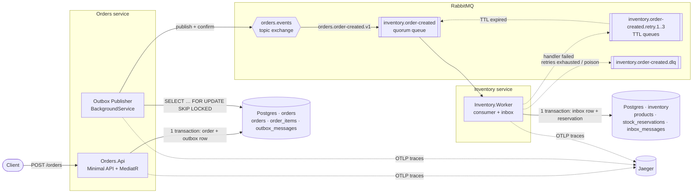
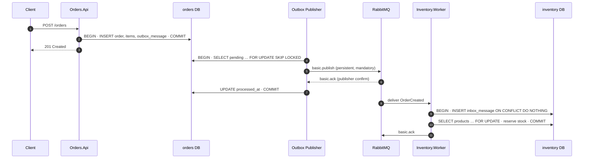
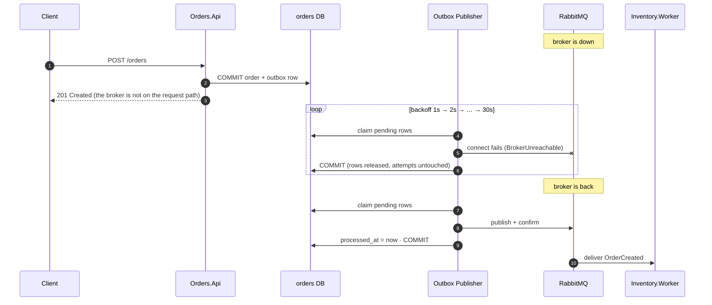
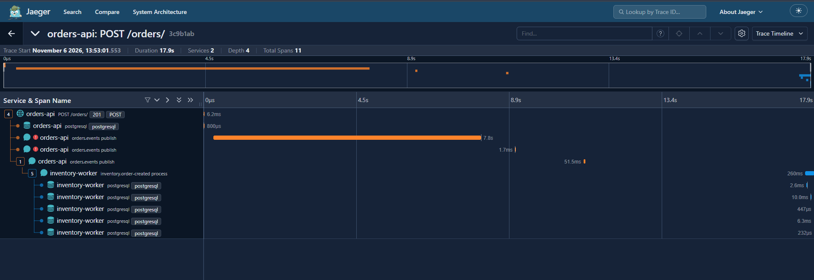
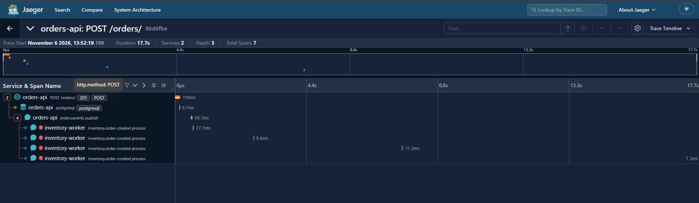
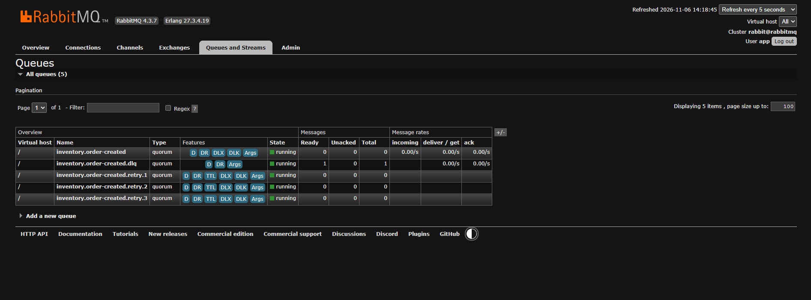
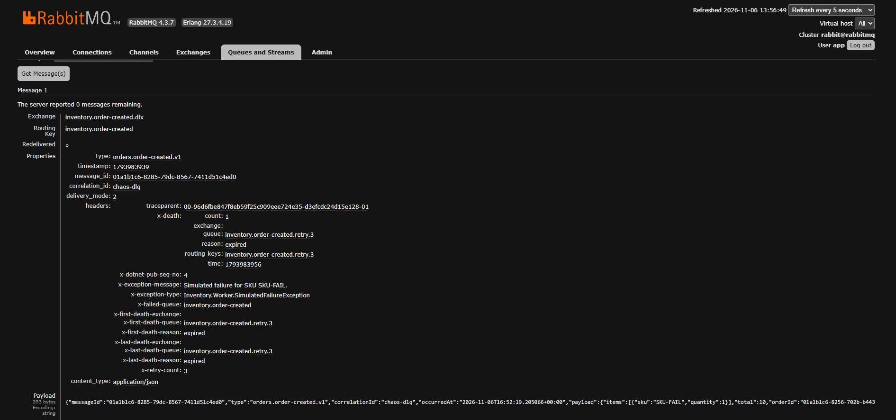
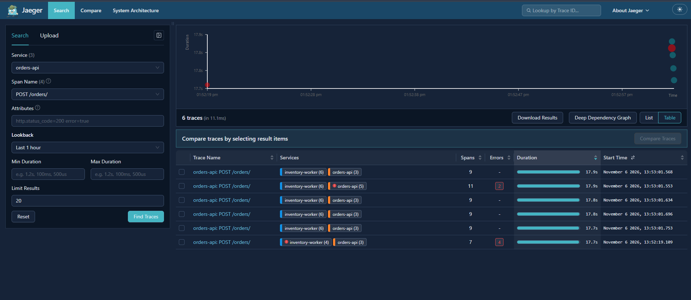

# dotnet-reliable-messaging

[](https://github.com/MarceloCambraia/dotnet-reliable-messaging/actions/workflows/ci.yml)


A reference implementation of the **Transactional Outbox** and **Idempotent Consumer (Inbox)** patterns
in .NET 10, PostgreSQL and RabbitMQ. It uses the plain `RabbitMQ.Client` library, with no MassTransit
or NServiceBus, so you can see every moving part: publisher confirms, manual acks, retry queues and
dead-lettering.

> 🇧🇷 [Resumo em português](#resumo-em-português) no final.

---

## The problem: dual writes

A service that must **change its database _and_ publish an event** is doing two writes to two
systems that share no transaction:

```csharp
await db.SaveChangesAsync();   // 1. commit the order
await bus.PublishAsync(evt);   // 2. publish OrderCreated — what if this throws?
```

- If step 2 fails, the order exists but nobody downstream will ever hear about it.
- If you publish first and the commit fails, consumers react to an order that never existed.
- If you wrap both in a `try/catch` and roll back, a broker outage now takes your business operation
  down with it.

I have seen the last case in production: the broker became unavailable and order creation started
failing, because publishing was coupled to the request's transaction. **This project shows the fix.**

## The solution at a glance

| Side | Pattern | Guarantee |
|---|---|---|
| Producer | **Transactional Outbox.** The event is stored in an `outbox_messages` row **in the same transaction** as the order. A background publisher sends it later, with publisher confirms. | The event is published **if and only if** the order was committed, and a broker outage never fails the request. |
| Consumer | **Idempotent Consumer (Inbox).** The consumer inserts the `MessageId` into `inbox_messages` (primary key) **in the same transaction** as its side effect. A duplicate inserts nothing and is skipped. | Redeliveries are harmless. |

At-least-once delivery plus idempotent processing gives an **effectively exactly-once** outcome.

## Architecture



### Happy path



### Broker unavailable



The consumer-side retry/DLQ flow is in [`docs/diagrams/sequence-consumer-failure.mmd`](docs/diagrams/sequence-consumer-failure.mmd).

## Run it

Requires Docker.

```bash
docker compose up --build
```

| What | Where |
|---|---|
| Orders API | <http://localhost:8080> (requests in [`Orders.Api.http`](src/Orders.Api/Orders.Api.http)) |
| RabbitMQ management | <http://localhost:15672> (`app` / `app`) |
| Jaeger | <http://localhost:16686> |
| Postgres | `localhost:5432` (`postgres` / `postgres`; databases `orders` and `inventory`) |

```bash
curl -i -X POST http://localhost:8080/orders \
  -H 'Content-Type: application/json' \
  -d '{"customerId":"c-1","items":[{"sku":"SKU-1","quantity":2,"unitPrice":149.90}]}'
```

Seeded products: `SKU-1` … `SKU-4` have stock. `SKU-5` has zero stock, so its reservation is
rejected. `SKU-FAIL` always makes the consumer fail, for the DLQ demo.

## Reproduce the failure scenarios

Each scenario has a live demo script (bash or PowerShell) and an automated test that proves it in CI.

| Scenario | Live demo | Automated proof |
|---|---|---|
| **Broker down:** `POST /orders` keeps returning 201, events wait in the outbox and drain when the broker returns | `./scripts/chaos.sh broker-down` | [`BrokerOutageTests`](tests/IntegrationTests/Outbox/BrokerOutageTests.cs) |
| **Duplicate delivery:** the same message twice produces one stock reservation | `./scripts/chaos.sh duplicate` | [`IdempotentConsumerTests`](tests/IntegrationTests/Inventory/IdempotentConsumerTests.cs) |
| **Consumer failure:** retried 3× with growing delays, then moved to the DLQ | `./scripts/chaos.sh dlq` | [`DeadLetterTests`](tests/IntegrationTests/Inventory/DeadLetterTests.cs) |
| **Competing publishers:** 2 instances never publish the same row (`SKIP LOCKED`) | `docker compose up --scale orders-api=3`¹ | [`OutboxConcurrencyTests`](tests/IntegrationTests/Outbox/OutboxConcurrencyTests.cs) |
| Message-level publish failures use backoff, then park; outages don't burn attempts | | [`OutboxRetryTests`](tests/IntegrationTests/Outbox/OutboxRetryTests.cs) |
| One trace spans request → publish → consume | open Jaeger after any order | [`TracePropagationTests`](tests/IntegrationTests/EndToEnd/TracePropagationTests.cs) |

On Windows, use `./scripts/chaos.ps1 -Scenario broker-down` (or `duplicate`, `dlq`).

¹ To scale, drop the fixed `8080:8080` host port in `docker-compose.yml` first.

## Tests

```bash
dotnet test                          # everything; integration tests need Docker running
dotnet test tests/UnitTests          # domain, handlers, envelope, headers, tracing, backoff
```

- **Unit tests:** domain invariants, the CQRS handlers (the order and its event are staged before a
  single commit), the envelope wire format, header parsing, W3C trace propagation, broker error
  classification and backoff math.
- **Integration tests:** real Postgres and RabbitMQ via **Testcontainers**, the real API via
  `WebApplicationFactory` and the real worker host. Tests isolate themselves with unique database,
  exchange and queue names, so the containers are shared and the suite stays fast.

Built with xUnit, FluentAssertions and NSubstitute. CI runs everything on every push and publishes
a coverage report.

## Project structure

```
src/
  Orders.Api/               Minimal API endpoints, health checks, Serilog, OpenTelemetry
  Orders.Application/       Commands/queries (MediatR), ports: IOrderRepository, IOutbox, IUnitOfWork
  Orders.Domain/            Order aggregate and invariants (no dependencies)
  Orders.Contracts/         Integration events shared with consumers (OrderCreated)
  Orders.Infrastructure/    EF Core, outbox table, OutboxProcessor (SKIP LOCKED) and publisher service
  Inventory.Worker/         OrderCreated consumer, inbox table, stock reservation
  BuildingBlocks.Messaging/ Envelope, RabbitMQ connection, confirmed publisher, retrying consumer, tracing
tests/
  UnitTests/
  IntegrationTests/         Testcontainers: Postgres + RabbitMQ
docs/diagrams/              Mermaid sources
scripts/                    chaos.sh / chaos.ps1
```

## Design decisions & trade-offs

### Why an outbox and not a distributed transaction (2PC)?
RabbitMQ does not take part in XA/2PC, and even where 2PC is available it couples the availability
of every participant: if one is down, all of them are. It also holds locks across the network and
needs a transaction coordinator that becomes a single point of failure. The outbox turns the problem
into **one local ACID transaction**, plus an asynchronous, retryable copy step. The price is
latency: events go out a few hundred milliseconds later, not inside the request.

### At-least-once + idempotency = effectively exactly-once
"Exactly-once delivery" is not achievable across a network, but an exactly-once _effect_ is. The
publisher may send a message twice: it can crash after the broker confirms but before it marks the
row. The consumer may also see a redelivery after a lost ack. So the consumer records the
`MessageId` in its inbox **in the same transaction as the side effect**. If the effect committed, the
inbox row exists and the duplicate is skipped. If it did not, neither exists and processing simply
runs again. The inbox primary key also serializes **concurrent** duplicates: the second insert waits
for the first transaction, then does nothing.

### Why polling and not CDC (Debezium)?
Polling with `FOR UPDATE SKIP LOCKED` needs nothing but the database you already have. It is easy to
reason about and test, and the partial index on pending rows keeps each poll cheap. I would move to
**CDC** (Debezium reading the Postgres WAL, or logical replication) when:
- throughput is high enough that polling latency or load becomes a concern;
- several services need the same pattern and a platform team can run Kafka Connect;
- strict per-aggregate ordering is required at scale, since the WAL is already ordered.

CDC removes polling, but adds infrastructure and replication slots to operate. A cheap middle step
is `LISTEN/NOTIFY` to wake the publisher right after a commit.

### Publisher details
- **`FOR UPDATE SKIP LOCKED`.** Each instance claims a disjoint batch, so you can run as many
  publishers as API replicas with no leader election. The rows stay locked while the batch is
  published. The alternative, a lease column (`locked_until`), shortens locks but adds a cleanup path.
- **Publisher confirms + `mandatory`.** A row is marked processed only after the broker _acks_ it.
  An unroutable message comes back as an error instead of being dropped silently.
- **Outage ≠ bad message.** Connectivity failures stop the batch _without_ consuming the message's
  attempt budget, and the service backs off from 1s to 30s. Only message-level failures (nack,
  unroutable) count attempts, use exponential backoff with jitter, and are parked as `failed` after
  `MaxAttempts`. A one-hour outage therefore never parks a valid message.
- **Readiness depends only on Postgres.** With RabbitMQ down, `/health` reports `Degraded` but
  `/health/ready` stays healthy. Pulling the API out of the load balancer during a broker outage would
  undo exactly what the outbox provides.

### Consumer details
- **Manual acks, prefetch 16, ack after commit.** If the process dies mid-message, the broker
  redelivers it and the inbox absorbs the duplicate.
- **One retry queue per delay (5s / 30s / 2min by default; compose uses 2s / 5s / 10s for the
  demo).** Each queue has its own `x-message-ttl` and
  dead-letters back into the main queue. A single queue with per-message TTLs would suffer from
  head-of-line blocking, because RabbitMQ only expires messages at the head of a queue.
- **Two routes to the DLQ.** When retries run out, the consumer republishes to the DLX with
  `x-exception-*` headers for diagnosis. A **poison message** (not a valid envelope) is
  `nack(requeue: false)`ed and the broker dead-letters it natively. Retrying it would be pointless.
- **Business outcomes are not errors.** Insufficient stock creates a `Rejected` reservation and the
  message is acked. Only technical failures go through retry and the DLQ.
- **Quorum queues.** They are the replicated, durable queue type recommended by RabbitMQ (classic
  mirrored queues were removed in 4.0).

### Why raw `RabbitMQ.Client`?
To show the mechanics a framework would hide: topology declaration, confirms, acks, reconnection,
dead-lettering and header-based trace propagation. In a production codebase I would seriously
consider MassTransit or NServiceBus, which ship with an outbox, an inbox, retries and observability.
Knowing what they do underneath makes them much easier to operate.

### Other choices
- **.NET 10 (LTS).** .NET 8 reaches end of support in November 2026. Nothing here depends on the
  version.
- **MediatR 12.x and FluentAssertions 7.x are pinned on purpose.** They are the last Apache-2.0
  versions; later major versions are commercially licensed.
- **Envelope:** `MessageId`, `Type` (versioned: `orders.order-created.v1`), `CorrelationId`,
  `OccurredAt` and `Payload` travel in the JSON body, so a message describes itself. The same values
  are mirrored in AMQP properties for tooling.
- **Tracing:** the outbox row stores the request's `traceparent`. The background publish span
  continues that trace, and the consumer span continues it from the AMQP headers. SQL is traced only
  inside an existing trace, so idle polling never floods Jaeger.

### What I would add for production
- **Outbox and inbox cleanup:** delete or archive processed rows after N days, in batches, or use
  time-partitioned tables and drop old partitions.
- **Ordering:** `SKIP LOCKED` with several publishers does not preserve order. If consumers need
  per-aggregate order, partition by aggregate id (one publisher per partition) or use RabbitMQ
  single-active-consumer / consistent-hash exchanges, and let consumers reject stale versions.
- **Partitioning / sharding** of the outbox for very high write volumes.
- **Metrics:** outbox lag (age of the oldest pending row), publish rate, DLQ depth, and alerts on them.
- **DLQ tooling:** inspect, replay and discard, with an audit trail.
- **Contract evolution:** schema registry or contract tests, and a policy for `v2` events.
- **Security:** TLS to the broker and the database, per-service credentials, and secrets from a vault.
- **Inbox per consumer:** key the inbox by `(consumer, message_id)` once one database hosts several handlers.

## Observability

- **Logs:** structured with Serilog. Every line carries `TraceId`, and request and consumer scopes add
  `CorrelationId` and `MessageId`.
- **Traces:** OpenTelemetry → OTLP → Jaeger. One trace shows `POST /orders` → the SQL insert → the
  later `orders.events publish` → `inventory.order-created process` → the inventory SQL.
- **Health:** `/health/live`, `/health/ready` (Postgres) and `/health` (everything, as JSON).
- **Outbox state:** `GET /diagnostics/outbox` returns pending / processed / failed counts and the
  oldest pending message.

## Screenshots

Captured from `docker compose up` after running `./scripts/chaos.ps1 -Scenario dlq` and
`-Scenario broker-down`.

**An order placed while RabbitMQ was down.** The request returns `201` in 6 ms. Two publish
attempts fail while the broker is stopped, the third succeeds about 10 s later, and the inventory
worker consumes the message, all in the same trace. The consumer starts a few seconds after the
publish because the worker was itself reconnecting with backoff; the message waited in the durable
queue.



**A message that keeps failing.** One publish, then four failed `process` spans in the worker: the
first delivery plus three retries, spaced by the retry queues' TTLs (2 s, 5 s, 10 s in compose).



**The queue topology after that run.** The main queue, three retry tiers (each with its own TTL,
dead-lettering back to the main queue) and the DLQ holding the failed message. All are quorum queues.



**The same message in the DLQ.** It keeps its `message_id`, `correlation_id` and `traceparent`, and
carries `x-retry-count: 3` plus the exception type and message for diagnosis.



**All six demo orders in Jaeger.** Each trace spans both services and lasts ~17 s, because the
publish or the consumption happened long after the request.



---

## Resumo em português

Implementação de referência dos padrões **Transactional Outbox** e **Idempotent Consumer (Inbox)**
com .NET 10, PostgreSQL e RabbitMQ, usando o `RabbitMQ.Client` puro para deixar o mecanismo visível.

**O problema.** Gravar no banco e publicar no broker são duas escritas sem transação em comum. Já vi
em produção uma indisponibilidade do broker derrubar a criação de pedidos, porque a publicação estava
acoplada à transação.

**A solução.**
- `POST /orders` grava o pedido e uma linha em `outbox_messages` **na mesma transação**. Um
  BackgroundService lê as pendentes em lote com `FOR UPDATE SKIP LOCKED`, publica com publisher
  confirms e marca a linha como processada.
- Uma queda do broker não consome o contador de tentativas. Falhas da própria mensagem usam backoff
  exponencial e, depois de N tentativas, a mensagem é marcada como falha.
- O consumidor grava o `MessageId` em `inbox_messages` (PK) na mesma transação da reserva de estoque,
  e uma mensagem duplicada é ignorada.
- Falhas técnicas passam por filas de retry com TTL (5s / 30s / 2min) e depois vão para a DLQ.
  Mensagens inválidas (poison) vão direto para a DLQ.

**Como rodar:** `docker compose up --build`. Os cenários de falha são reproduzidos ao vivo com
`./scripts/chaos.sh broker-down | duplicate | dlq` (ou `chaos.ps1` no Windows), e cada um tem um teste
de integração com Testcontainers que roda no CI.

**Trade-offs principais:** outbox em vez de 2PC (o RabbitMQ não participa de XA, e o 2PC acopla a
disponibilidade de todos os participantes); at-least-once mais idempotência dá efeito exactly-once;
polling em vez de CDC pela simplicidade operacional (CDC/Debezium entra com alto volume ou quando a
ordenação estrita importa). Para produção ficariam a limpeza do outbox e do inbox, a ordenação por
agregado, o particionamento, as métricas e alertas e uma ferramenta para reprocessar a DLQ.
